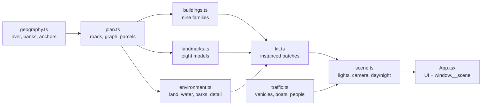

# Architecture

Bangkok Miniature is a static React + TypeScript + three.js scene. The 3D scene is plain three.js;
React only owns the overlay UI and the capture surface. The whole thing builds into one HTML file.

The design is **road-first**: define the river and the banks, reserve the landmark and park
footprints, build a connected street graph, then place buildings on the parcels that remain. This
keeps the city coherent instead of scattering boxes on a plane.

## Construction order

`createCity()` in `src/scene/scene.ts` runs in this order:

1. Renderer, camera, controls, sky, lights and the PMREM environment.
2. `planCity()` from `plan.ts`, which calls `geography.ts` for the banks and reserved sites.
3. Ordinary buildings through `buildings.ts` into a shared `Kit`.
4. The eight landmark models through `landmarks.ts` into the same `Kit`.
5. `buildEnvironment()` for land, tray, water, roads, bridges, promenade, piers, parks, trees, stalls
   and spirit houses. The environment adds static detail to the `Kit`; `kit.finish()` then emits the
   instanced meshes.
6. `addTraffic()` for vehicles, pedestrians, river boats and the Rama VIII bridge cars.
7. Camera blockers from the parcel and landmark envelopes.
8. The first `tick()`, which renders the scene and reports `facts`.

Anything that needs the street network must run after step 2. Anything that needs the final
materials must run before `kit.finish()`.

## Coordinate system and geography

- North is `-z`; east is `+x`; up is `+y`.
- The tray is **12.6 × 33.5 units**. The land top is at `y = 0.46`, roads at `0.65`, buildings at
  `0.69`, water at `0.28`.
- The Chao Phraya is a centreline with a half-width of about **1.28–1.35 units**. The banks are two
  closed polygons built from outer-edge points and the river edge points. The river is deliberately
  wide: it is the composition's central ribbon.
- `insideLand()` tests both bank polygons. The road grid is clipped to it; the river is a real gap,
  not a painted stripe.
- `LANDMARKS` in `geography.ts` is the single source of truth for each landmark's anchor, reserved
  footprint, look height, camera offset and yaw. `scripts/verify.mjs` repeats the camera targets.

## Street plan and graph

`plan.ts` combines:

- **Named major roads** (Ratchadamnoen, Charoen Krung, Yaowarat, Rama I, Sukhumvit, Silom, Rama IV,
  Arun Amarin, Wang Doem and connectors) as authored polylines.
- **A clipped rotated grid** at `angle = -0.28`, sampled every 0.28 units so a run stops at the
  coast instead of routing a long chord across water.
- **Bridge spans** at Memorial Bridge, Phra Pokklao and Krungthep. The water span is an explicit
  edge marked `bridge: true`; the approaches are ordinary roads. The span starts and ends on land,
  which `tests/plan.test.ts` checks.
- **A planar graph**: every crossing is split into a node; duplicate edges are removed; components
  smaller than 8 nodes are dropped. The graph is one connected city, including both banks.
- **Street-front parcels** along the major roads, then a **lattice fill** that shares the same
  spatial hash, so the two passes cannot overlap. Parcels keep a local `rot` and a conservative
  road-clearance check.

The graph is used by traffic. Vehicles move from node to node, stop at red phases and choose a
random neighbour at the end of an edge. The same graph gives the pedestrian walks their sidewalk
paths.

## Buildings and landmarks

`Kit` (`src/scene/kit.ts`) batches boxes, cylinders, square prisms, spheres and beams per material
and emits one `InstancedMesh` per batch. Custom geometry (the Golden Mount spiral, park paths) is
merged per material at `finish()`. Per-instance colours keep the scene to a few draw calls.

`buildings.ts` has nine families: shophouse, heritage, low-rise, market, mixed-use, condo, office,
hotel and pixel tower. Family choice and height are driven by district and a seeded RNG. The
ordinary buildings are deliberately procedural; only the eight landmarks are hand-authored.

`landmarks.ts` uses the same kit. Each model is authored in local coordinates and placed by
`kit.at(anchor.x, anchor.z, 0.69, yaw)`. The models are:

| Landmark | Signature |
| --- | --- |
| Grand Palace | Walled compound, golden chedi, green and gold Thai roofs, gate |
| Wat Arun | Central prang, four small prangs, river landing |
| Wat Pho | Long hall, reclining Buddha, four tiled chedis, cloister |
| Giant Swing | Two red teak columns, crossbeam, Wat Suthat behind |
| Golden Mount | Green hill, spiral ramp, golden chedi, ceremonial umbrella |
| Baiyoke Tower II | Slender shaft, gold observation ring, long antenna |
| Mahanakhon | Pixelated glass tower with a spiral cutout and sky deck |
| Rama VIII | Inverted-Y pylon, cable fan, river deck and bridge cars |

The landmark envelopes are checked in `tests/geometry.test.ts`; widen a lot before growing a model
past its envelope.

## Environment and city life

`environment.ts` builds the tray, two land meshes, the animated water surface, roads, sidewalks,
bridges, the river promenade, piers, parks (Lumphini, Sanam Luang and a riverside park), tropical
trees, street stalls, spirit houses and lamp pools. The water is a `MeshStandardMaterial` with a
small vertex displacement and a fragment normal perturbation; its colour and night streaks are
driven from `update(time, night)`.

`traffic.ts` adds 40 vehicles (taxis, cars, tuk-tuks, buses and trucks), 60 pedestrians and three
river boats. Vehicle models are merged low-poly parts with per-vertex colours; the head/tail lights
use separate emissive materials. Four cars cross the Rama VIII deck using the bridge anchor's yaw,
so the lane is never hardcoded in world space.

## Scene, camera and capture

`scene.ts` owns:

- the renderer (ACES tone mapping, PCF shadows, pixel ratio capped at 1.6);
- the sun, hemisphere and fill lights, sky dome and fog;
- the day/night blend (`night` 0 → 1): light intensities, colours, exposure, environment intensity,
  water, window emissive and lamp glow;
- OrbitControls with damping, distance limits and a camera guard that lifts the camera out of a
  building envelope;
- camera flights: `focus(i)` eases position and target with a small arc; `reset()` returns home;
  `zoom`, `orbitBy` and `panBy` are deterministic helpers;
- `tick(dt)`, which advances the virtual clock and renders one frame.

All motion uses `tick(dt)`. There is no `performance.now()` in the simulation. In `?capture=1`
mode the RAF loop is not started; `window.__scene.step(n, dt)` advances the scene from outside. This
is what makes `npm run verify` frame-rate independent.

`App.tsx` installs `window.__scene` with `inspect()`, `act()`, `step()` and `script()`, and owns the
React state for day/night, selection, language, layout and the screenshot modal.

## UI and layouts

`body[data-layout]` is `compact` below 900 px wide or 560 px high, otherwise `full`. The full layout
uses a left title column and shifts the camera right with `setViewOffset`; the compact layout hides
the intro and stacks the landmark bar into a 4×2 grid. `?embed=1` hides the header, intro and
collectible line. `?lang=th` switches the copy; the language button toggles live.

The landmark bar is a flex row on desktop and a 4×2 grid in compact. Below 1350 px it drops the
decorative arrow and shortens the type so all eight names remain readable.

## Testing and determinism

- `tests/plan.test.ts` checks parcel containment, road clearance, non-overlap, a connected graph,
  bridge spans, landmark anchors and river width.
- `tests/geometry.test.ts` checks finite geometry, non-singular instance matrices, landmark
  envelopes, unique landmark geometry and nine distinct building families.
- `scripts/verify.mjs` drives the single-file build in headless Chrome under the sandbox CSP and
  checks 22 interactions and layouts.
- `scripts/shot.mjs` is a visual screenshot harness; it is not a gate.

All placement is seeded. `planCity(1946)` and the building/environment/traffic RNGs are stable, so a
capture at 1/30 s matches a live page at any frame rate.

## Extension points

- **A new landmark**: add the model in `landmarks.ts`, add the anchor to `LANDMARKS` in
  `geography.ts`, add the id to `config.ts`, add the i18n keys, map the builder in `scene.ts`, add
  the envelope in `tests/geometry.test.ts` and the target in `scripts/verify.mjs`.
- **A new building family**: add the type and builder in `buildings.ts`, add it to `FAMILIES` and
  `addBuilding`, weight it in `plan.ts`, and add the family to the geometry test.
- **A new locale**: add the block to `src/i18n.ts`, update `LANGS`/`normaliseLang`, and add a locale
  check to `scripts/verify.mjs`.
- **A geography change**: adjust the river table and bank outer edges, then re-check every landmark
  anchor, major road and bridge. The plan test is the fastest way to see what detached.

See [docs/customization.md](docs/customization.md) for step-by-step recipes.
