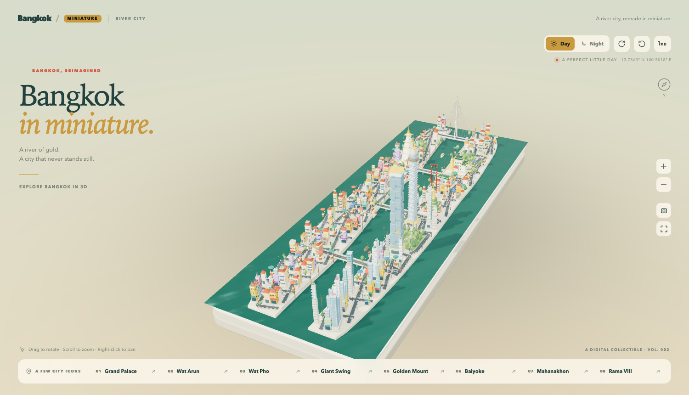

# Bangkok Miniature

[](https://github.com/somphol/bangkok-miniature/actions/workflows/ci.yml)
[](https://somphol.github.io/bangkok-miniature/)
[](LICENSE)

**v0.1.0 · 22/22 verification checks · 8 landmarks · English / Thai**



An interactive 3D miniature of Bangkok built from scratch with React, TypeScript and three.js.
The Chao Phraya runs through the middle of a floating tabletop tray; the historic east bank holds
the Grand Palace, Wat Pho and the old town, the west bank holds Wat Arun, and the modern skyline
runs south through Siam and Silom. Cars, taxis, tuk-tuks, buses and trucks cross the bridges,
long-tail boats and river ferries work the water, and the whole scene switches between a hazy day
and a neon night.

The geography is compressed for the diorama: it is a recognisable Bangkok, not a survey map.

**Live:** <https://somphol.github.io/bangkok-miniature/>

## Landmarks

| # | Landmark | District |
| - | -------- | -------- |
| 01 | Grand Palace | Rattanakosin |
| 02 | Wat Arun | Thonburi |
| 03 | Wat Pho | Phra Nakhon |
| 04 | Giant Swing | Sao Chingcha |
| 05 | Golden Mount | Pom Prap |
| 06 | Baiyoke Tower II | Ratchathewi |
| 07 | King Power Mahanakhon | Silom |
| 08 | Rama VIII Bridge | Chao Phraya |

## Run

Requires Node.js **22.4 or newer** and a browser with **WebGL 2**. Chrome or Chromium is also needed
for `npm run verify` and `npm run shot`.

```sh
npm ci
npm run dev            # live development server
npm run build:single   # -> dist-single/index.html, one self-contained file
npm test               # plan and geometry checks, no browser
npm run verify         # builds the single file and drives it in headless Chrome
npm run shot           # writes day/night and landmark screenshots to shots/
```

`npm run verify` uses virtual time in capture mode, so it is frame-rate independent and works on
machines without a GPU-backed headless Chrome. `npm run shot` uses SwiftShader and is for visual
inspection, not a pass/fail gate.

## Controls

- **Eight landmark buttons** fly the camera to a dedicated view.
- **Day / Night**, **auto rotate**, **reset**, drag to orbit, right-drag or arrow keys to pan,
  wheel or **+ / −** to zoom.
- **Camera** saves a PNG; **fullscreen** is available outside a sandbox.
- `?lang=th` switches the interface to Thai (the language button also toggles live).
- `?embed=1` shows the compact embed layout, `?capture=1` enables frame stepping, and
  `?view=topdown|oldtown|silom|river|bridge` selects a debug starting viewpoint.

The scene makes no network, storage or model calls. It uses system fonts only, and the single
file runs under `sandbox allow-scripts; default-src 'none'; …` with no external requests.

## Documentation

| Document | What it covers |
| --- | --- |
| [Getting started](docs/getting-started.md) | Install, run, build, controls and URL parameters |
| [Architecture](ARCHITECTURE.md) | Construction order, coordinates, road graph, rendering and capture |
| [Verification](docs/verification.md) | Unit/geometry tests, headless checks and the capture API |
| [Deployment](docs/deployment.md) | GitHub Pages, single-file build, CSP, caching and rollback |
| [Customization](docs/customization.md) | Move a landmark, add a family, change geography or add a locale |
| [Landmarks](docs/landmarks.md) | Anchor/view table, model notes and envelope invariants |
| [Performance](docs/performance.md) | Budgets, instancing, shadows, water and profiling |
| [Internationalization](docs/i18n.md) | English/Thai copy, adding a locale and typography |
| [Design notes](docs/design-notes.md) | Art direction, composition, palette, camera and UI |
| [Changelog](CHANGELOG.md) | Release history |
| [Contributing](CONTRIBUTING.md) | Setup, tests, style, pull requests and the release checklist |
| [Security](SECURITY.md) | Supported versions, reporting and the offline/CSP model |
| [Support](SUPPORT.md) | Where to ask and what to include |
| [Attribution](ATTRIBUTION.md) | Provenance, inspiration and dependency licences |
| [Roadmap](ROADMAP.md) | Directions and non-goals |

## How it is put together

The city is planned road-first, then filled:

1. `src/scene/geography.ts` — the river centreline, the two bank polygons, bridges, parks and the
   eight landmark anchors.
2. `src/scene/plan.ts` — named major roads plus a clipped rotated street grid, a connected road
   graph (with real bridge spans), and street-front shophouses followed by a lattice of parcels.
3. `src/scene/buildings.ts` — nine Bangkok building families: shophouse, heritage, low-rise,
   market, mixed-use, condo, office, hotel and pixel tower.
4. `src/scene/landmarks.ts` — the eight dedicated models, authored with the instancing kit in
   `src/scene/kit.ts`.
5. `src/scene/environment.ts` — land, tray, water, roads, bridges, promenade, piers, parks, trees,
   stalls, spirit houses and lamp glow.
6. `src/scene/traffic.ts` — traffic on the graph, Rama VIII bridge cars, river boats and pedestrians.
7. `src/scene/scene.ts` — renderer, camera flights, day/night, capture API and disposal.
8. `src/App.tsx`, `src/i18n.ts`, `src/style.css` — the overlay UI in English and Thai.

All placement is seeded, and the simulation advances only through `tick(dt)`, so a capture stepped
at 1/30 s matches a live page at any frame rate.

## Verification

`npm test` checks:

- every parcel is on land, clear of roads and reserved sites, and does not overlap another parcel;
- the road graph is one connected city, and every bridge span starts and ends on land and crosses
  water;
- every landmark has finite, non-singular geometry inside its authoring envelope;
- the nine building families have distinct geometry.

`npm run verify` checks the single-file build in headless Chrome: eight landmark flights, the
chosen button and info card, day/night, reset, zoom, orbit, pan, rotate, both locales and the
345×345 embed, with no console errors and no external requests.

## Notes

- The geography is interpretive and compressed; positions and scales are not survey data.
- The city is intentionally dense but small: about 140 buildings, 1,200 road edges, 40 vehicles
  and 3 boats on the river.
- Headless Chrome without a GPU-backed path falls back to SwiftShader; `npm run verify` is the
  frame-rate independent check. The live page is happiest with hardware WebGL 2.
- The implementation is original. It shares the general idea of a landmark-driven tabletop
  diorama with other city miniatures, but no San Francisco scene code or geography is reused.

The deployable artifact is `dist-single/index.html`. The published copy lives at
`docs/index.html` for GitHub Pages.

## Contributing

Contributions are welcome when they keep the project a small, self-contained diorama. Read
[CONTRIBUTING.md](CONTRIBUTING.md) and [ARCHITECTURE.md](ARCHITECTURE.md) first; the landmark anchor
table and the verification targets must move together. By participating you agree to the
[Code of Conduct](CODE_OF_CONDUCT.md).

## Security

The scene has no server, accounts, storage or runtime network calls. Report a security problem
privately as described in [SECURITY.md](SECURITY.md); do not open a public issue.

## Licence

The Bangkok Miniature source is released under the MIT licence. The production bundle includes
React, React DOM, Scheduler and three.js, all MIT; their notices are in
[THIRD_PARTY_NOTICES.txt](THIRD_PARTY_NOTICES.txt).
